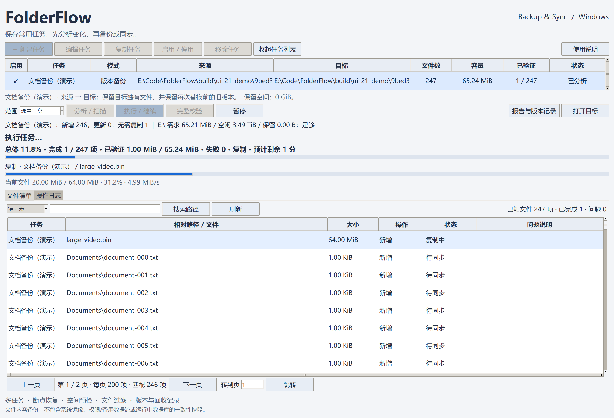

# FolderFlow

A portable Windows folder backup and **one-way** synchronization tool.
Extract the release ZIP and run `FolderFlow.exe`. No installer or separate Python installation is required.

[中文 README](README.md) · [Build instructions](docs/BUILD.md) · [Release process](docs/RELEASE.md)

## Screenshot



Chinese UI with demo files, showing overall and current-file progress alongside the searchable, paginated sync queue.

## Features

- Named independent tasks, selected-task or enabled-task batch execution.
- Local folders, removable disks, mapped drives and Windows SMB shares.
- Versioned backup, one-way update and recoverable mirror synchronization.
- Size/time change detection, SHA-256 verification, resumable copies and prefix validation.
- Capacity preflight, configurable reserved space, include/exclude globs, retries and transfer limits.
- Durable SQLite state, operation logs, file manifests and retained-version records.
- Searchable 200-item manifest pages with pending/completed/failed/mirror filters.
- Separate overall and current-file progress, verified bytes, item totals, errors and estimated remaining time.

Source folders remain read-only. Versioned backup and one-way update preserve destination-only files.
Mirror mode moves destination-only files into recoverable storage; source errors stop recycling.
There is no bidirectional merge, background scheduler, system imaging or application-consistent database snapshot.

## Use the portable build

1. Extract the `windows-x64-portable.zip` into a writable folder.
2. Run `FolderFlow/FolderFlow.exe` and create a task.
3. Analyze changes and available space, then execute.
4. Run full verification for important backups.

Configuration and state live beside the executable in `data/`; reports live in `reports/`.
Keep `data/` when upgrading. No services or installation entries are registered.
The single-file bundle temporarily extracts runtime files into the system temp folder during startup.

## Build on Windows

Use Python 3.13 x64 with Tcl/Tk. The locally validated OS is Windows 11 x64.
From the repository root:

```powershell
powershell -NoProfile -ExecutionPolicy Bypass -File .\scripts\build.ps1
```

This creates a local `.venv`, installs pinned build dependencies, runs the tests and produces:

- `dist/FolderFlow/FolderFlow.exe`
- `dist/FolderFlow-2.1.0-windows-x64-portable.zip`
- `dist/SHA256SUMS.txt`

The release is built from an explicit allowlist in a fresh staging directory.
Local configuration, manifests, logs and backup data are never included.
Application runtime dependencies are standard-library only. PyInstaller is a build dependency.

For development:

```powershell
python -m venv .venv
& .\.venv\Scripts\python.exe -m pip install -e .
& .\.venv\Scripts\python.exe -m folderflow
```

Tests:

```powershell
powershell -NoProfile -ExecutionPolicy Bypass -File .\scripts\test.ps1
```

Tests use isolated temporary folders. CI builds Windows artifacts and does not automatically publish releases.

## Data scope

Copies regular file content and directories; excludes ACLs, ownership, alternate streams and links/reparse points.
Full verification is per-file, not an atomic snapshot. Stop writes or use native application exports for live databases.
Destination-side permissions and encryption apply; FolderFlow does not provide its own encryption or key recovery.
Retained versions and mirror recycling are not automatically purged. Paths are listed in `retained-versions.csv`.

Overall progress includes already-verified files in the selected scope. Copies and two hash passes
contribute partial progress; only verified publication counts as a completed file. Failed/paused runs
do not show successful 100%. Empty files use item counts; remaining time is an estimate.
Pause and close a running older build before upgrading; keep `data/` to resume.

MIT applies to application source. Bundled runtime components retain their own licenses:
[LICENSE](LICENSE), [third-party notices](THIRD_PARTY_NOTICES.md).
