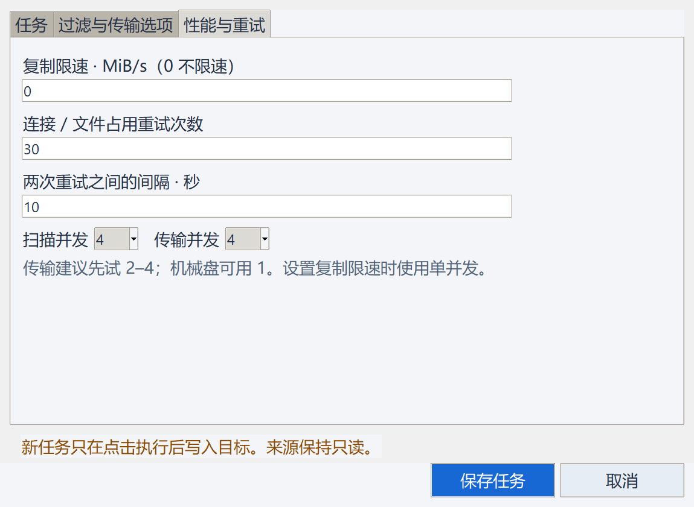

# FolderFlow

**绿色 Windows 文件备份与单向同步工具。解压后双击运行，无需安装、无需另装 Python。**

[English](README.md) · [详细使用说明](docs/user-guide.txt) · [编译 EXE](docs/BUILD.md) · [发布说明](docs/RELEASE.md)

FolderFlow 将常用的“来源 → 目标”保存为任务，先分析文件变化和空间需求，再执行复制。
支持本机目录、移动硬盘、映射盘和 Windows SMB 共享。新安装没有预设任务，也不会自动运行。

## 界面截图


截图使用演示文件，展示总体进度、当前文件传输进度，以及可搜索、分页的待同步清单。

## 功能

- 独立任务管理：新建、编辑、复制、启用/停用，单任务或批量运行。
- 中英双语：默认跟随 Windows 界面语言；可手动选择 English / 简体中文并保存。
- 完整文件清单：待同步/全部/完成/失败/镜像回收筛选，路径搜索、每页 200 项与页码跳转。
- 两级进度：总体百分比、完成项目数、已验证容量、问题数、预计剩余时间，以及独立单文件进度。
- 按大小与修改时间检测新增和改动；完整校验使用两端 SHA-256。
- 可调并发：扫描/分析 1–16 个线程，文件传输 1–8 个线程；线程只做 I/O，清单和完成状态统一提交。
- 断点恢复、续传前缀核对、网络重试、复制限速。
- 同盘容量需求合并计算，可配置保留空间。
- 通配符包含/排除规则，支持跳过目录子树。
- 旧版本与镜像回收记录，操作日志、CSV 清单和 JSON 报告。

| 模式 | 行为 | 目标独有文件 |
| --- | --- | --- |
| 版本备份 | 复制新增和改动，保留替换前的旧版本 | 保留 |
| 单向同步 | 来源更新到目标；可选保留旧版本 | 保留 |
| 镜像同步 | 来源更新到目标，使入选文件集合一致 | 移入可恢复回收区 |

同步方向始终是**来源 → 目标**。目前没有双向同步、冲突合并或定时后台服务。

## 绿色版怎么用

1. 解压 `FolderFlow-2.4.0-windows-x64-portable.zip` 到一个有写权限的目录。
2. 双击 `FolderFlow/FolderFlow.exe`。
3. 点击 **新建任务**，选择来源、目标与模式。
4. 选中任务，点击 **分析 / 扫描**，检查变化与空间需求。
5. 点击 **执行 / 继续**；重要备份完成后运行 **完整校验**。

程序不注册服务或安装项。任务和日志保存在程序旁的 `data/`，报告在 `reports/`。
绿色包包含 `FolderFlow.exe` 和 `_internal/` 运行库目录，移动时须保留整个软件目录，不能单独移动 EXE。
启动时直接加载附带运行库，省去每次临时解包；界面先显示，历史任务统计与清单在后台加载。
升级时保留 `data/`，替换程序和附带文档。若移动软件，请移动整个软件目录。
软件已打开时，再次双击会提示已有实例。切换新版之前，请关闭同一目录中的旧版窗口。
卸载时删除软件目录即可；目标中的备份与历史版本由你自行保留。

新任务的副本直接写到目标目录；`.folderflow/任务ID/` 保存续传文件、版本和回收内容。
来源与目标不能互相包含。软件自身也应放在来源目录之外。
使用当前 Windows 会话的共享凭据，软件不收集密码；需要时先在资源管理器连接网络共享。

右上角 `Language / 语言` 可选跟随系统、English 或简体中文。默认根据 Windows 的
**界面语言**选择：中文系统用简体中文，其他系统用英文。空闲时切换立即生效，运行任务时
暂时禁用切换。选择保存在本地配置中，任务编号、路径、文件名和断点记录不会被翻译或重置。

## 调整性能

编辑任务 → **性能与重试**：扫描并发默认为 4，传输并发默认为 1。大量小文件可先试
2–4 个传输线程；目标机械盘繁忙时降低到 1。开启复制限速后按单线程执行，保持任务总限速。
并发重叠网络读取、目标写入和校验等待；每个文件仍重新读取来源与本地副本比对 SHA-256，
只有通过校验并完成发布才计为完成。总体进度合计所有活跃文件，显示活跃文件数量。

文件清单按批次写入；扫描未完成时不会执行。复制成功仍逐项持久化，暂停后保留所有未发布的续传文件。
完整校验仍是逐文件执行。单个大目录的枚举，以及已占满网络/硬盘带宽的大文件，不保证从并发获益。
参见 [性能说明和隔离基准](docs/PERFORMANCE.md)。



## 从源码运行

开发和构建使用 **Windows x64、Python 3.13 x64（带 Tcl/Tk）**。
运行成品 EXE 不需要 Python。当前本地验证平台是 Windows 11 x64。

在仓库根目录打开 PowerShell：

```powershell
python -m venv .venv
& .\.venv\Scripts\python.exe -m pip install -e .
& .\.venv\Scripts\python.exe -m folderflow
```

应用运行时只使用 Python 标准库；PyInstaller 等依赖仅用于构建。

## 一键编译绿色版 `.exe`

安装 Python 3.13 x64 后，在仓库根目录运行：

```powershell
powershell -NoProfile -ExecutionPolicy Bypass -File .\scripts\build.ps1
```

脚本会创建仓库内的 `.venv`、安装固定版本构建依赖、运行测试、生成 EXE，最后打包。
`ExecutionPolicy Bypass` 仅对这个 PowerShell 进程生效，不永久修改系统策略。

产物：

```text
dist/
  FolderFlow/
    FolderFlow.exe
    使用说明.txt
    LICENSE
    third_party/
    ...
  FolderFlow-2.4.0-windows-x64-portable.zip
  SHA256SUMS.txt
```

构建采用 `--onedir --contents-directory _internal --windowed`，包含 Python、Tk 和所需运行库，无控制台窗口、无安装器。
发布 ZIP 从新建暂存目录按公共文件白名单和构建生成的运行库目录生成，**不会收集本机 `data/`、`reports/` 或备份内容**。
更多手动命令和常见问题见 [BUILD.md](docs/BUILD.md)。

## 测试

```powershell
powershell -NoProfile -ExecutionPolicy Bypass -File .\scripts\test.ps1
```

测试在临时目录运行，不访问真实 NAS，也不修改个人任务。
覆盖续传、损坏副本、源改动、空间不足、过滤、镜像回收、限速、独立任务和发布包隔离。
GitHub Actions 在 Windows 上运行测试并构建便携包；不会自动发布 GitHub Release。

## 范围与恢复

FolderFlow 备份普通文件的主数据流和目录，不提供系统镜像、ACL/所有者、备用数据流、
链接复制、快照或运行中数据库的一致性备份。文件系统自身的路径、文件名和单文件大小限制仍然适用。
数据库等持续写入内容应使用应用导出或停写后的复制。逐项校验不是原子快照。

旧版本与镜像回收内容不会自动清理。通过报告里的 `retained-versions.csv` 找到存放位置，
将对应文件复制回所需目录即可恢复。目标文件的加密和权限由目标设备本身决定。

总体进度针对当前运行范围，包含之前已经完成的文件。按文件数据量计算，复制与两次
哈希读取贡献过程进度，发布且验证后的副本才计入“已完成/已验证”。失败、暂停或最后
的目录/镜像整理未结束时不会显示成功 100%；零字节文件按项目数计。预计剩余时间是估算。
扫描期间容量尚不完整，进度条显示为活动状态；文件清单只读分页，不一次加载全部记录。
任务列表可收起，日志放在独立页；较小屏幕提供页面滚动，避免新增进度和清单控件被截断。
当前备份在运行时，先暂停并关闭旧软件，再替换新版；保留 `data/` 继续，避免中断状态或覆盖运行中的 EXE。

## 仓库结构

```text
src/folderflow/    应用与复制引擎
tests/            隔离测试
scripts/          测试、构建、白名单打包
packaging/        Windows manifest
docs/             使用、构建、发布文档
third_party/      随绿色版分发的第三方许可
.github/          Windows CI 与问题模板
```

运行数据、日志、虚拟环境、EXE 和 ZIP 均在 `.gitignore` 中，二进制应随 Release 分发。

## 贡献与许可

欢迎提供可复现问题和改进；请先阅读 [CONTRIBUTING.md](CONTRIBUTING.md)。
安全问题见 [SECURITY.md](SECURITY.md)。
应用源码采用 [MIT License](LICENSE)；打包运行库保留各自许可，详见 [第三方说明](THIRD_PARTY_NOTICES.md)。
